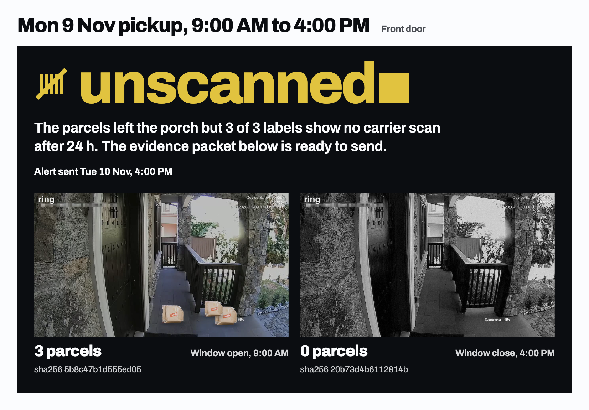

# Seen Off

Carrier-pickup proof for people who ship from home, built on the Ring Partner API.

**Watch it run: [seen-off-demo.fly.dev](https://seen-off-demo.fly.dev)** plays three pickup days through the real pipeline, no sign-in. Code: [github.com/kamalbuilds/seen-off](https://github.com/kamalbuilds/seen-off).



**29 of 30 pickup days called correctly, and a parcel on the porch read correctly in 59 of 60 frames (98.3%).** Across 60 recorded pickup days, the 30-day set above plus a second 30-day set built with a different seed, no day with parcels still on the porch was reported as taken.

A seller leaves parcels on the porch for a scheduled USPS or UPS pickup. Seen Off watches the porch through the Ring doorbell, reconciles it against that day's Shippo labels and the carrier's tracking, and gives one verdict per pickup day:

| Verdict | Meaning | What the seller gets |
|---|---|---|
| taken | every parcel left the porch and every label shows a carrier scan | nothing to do |
| missed | the parcels are still on the porch when the window closes | an alert with the parcel count while there is time to drop them off |
| part-taken | some parcels left, some did not | an alert: "1 of 3 parcels taken, 2 still on the porch" |
| unscanned | the parcels left the porch but a label still shows no carrier scan 24 h later | an evidence packet: Ring-watermarked frames, handoff time, label list, tracking status |

When a frame cannot be read, the seller is alerted to check the Ring app. Seen Off never reports a pickup it did not see.

## Run it

```
npm run serve:replay      # the seller page and the three-day demo on :8788, no credentials
npm test                  # 120 tests: signature, receiver, verdicts, replay regressions, runner, scheduler restart, plan validation, packet and provenance, dispute kit and claim grounding, Ring client, probe, Shippo, HTTP server
npm run mutation          # 55 mutations: signature, idempotency order, verdict logic, scheduler persistence, plan validation, replay, public demo, claim grounding, alerts, evidence hashes, token store, scoring. Each must turn the suite red
npm run test:whep         # WHEP worker against a local WHEP server serving a real frame
cp .env.example .env      # names only; fill values yourself
npm run ring:probe        # one real device discovery and frame capture, once RING_* is set
npm run serve
```

`npm run serve:replay` needs no keys. With no Bedrock key, each porch frame is answered by the reading Qwen3-VL gave for those exact bytes in one recorded live pass over all 169 replay frames, looked up by the frame's sha256 (`simulator/qwen3-vl-reads.json`, `src/vision/recorded.ts`, recorded by `scripts/record-reads.ts`). A frame with no recorded reading is stored as unreadable, never guessed. With `AWS_BEARER_TOKEN_BEDROCK` set, the same page reads every frame live on Bedrock and each packet names the model that read it.

`scripts/fly-deploy-demo.sh` deploys the public demo (`fly.demo.toml`): `replay-serve --public` binds the internet-facing app read-only, so arming, deleting and every Ring route answer `403`, while the replay drives a loopback-only twin over the same ledger.

Requirements: Node 24 (type stripping, `node:sqlite`, `node:test`), no npm dependencies. The WHEP worker needs Python 3.12 with `worker/requirements.txt`; the frame builders need `requirements.txt`.

## Measured

Every number below is reproducible from this repo. The two must-fail rows show the checks can go red.

**Is a parcel on the porch?** 60 Ring-watermarked doorbell-angle frames, 30 present and 30 gone, labels committed before any model call (`spikes/porch`).

| Run | Result |
|---|---|
| Bedrock Qwen3-VL, present or gone | 59/60 = 98.3% (real footage 35/35, median 1.33 s per frame) |
| Bedrock Qwen3-VL, parcel count exact | 49/53 = 92.5% |
| Must-fail: always answers "present" | 30/60 = 50.0% |
| Must-fail: parcels painted out of 10 frames the model had read as present | 10/10 flip to "gone" on Bedrock Qwen3-VL |

Frames: two real fixed-camera doorstep clips from Wikimedia Commons (CC BY 3.0, `spikes/porch/ATTRIBUTION.md`), parcel cut-outs composited onto their empty backgrounds, exposure and infrared-style variants. The Ring watermark follows the Computer Vision Guidelines: wordmark top-left, device id, app name and timestamp top-right, fixed pixel size.

`node spikes/porch/run.ts main` (Bedrock by default when `AWS_BEARER_TOKEN_BEDROCK` is set)

**By condition**, the same 60 frames split every way that matters on a porch (`spikes/porch/breakdown.py`, output in `spikes/porch/results/breakdown-main-bedrock-mantle.json`). Night and infrared are measured from the pixels, not taken from the labels.

| Condition | Frames | Present or gone | Parcel count exact |
|---|---|---|---|
| Empty porch | 30 | 30/30 (no false alarm) | 30/30 |
| Parcels on the porch | 30 | 29/30 | 19/23 |
| Real fixed-camera footage | 35 | 35/35 | 28/28 |
| Daylight | 53 | 53/53 | 44/46 |
| Night and infrared | 7 | 6/7 | 5/7 |
| Empty porch under exposure and infrared variants | 12 | 12/12 | 12/12 |
| 1 parcel | 18 | 17/18 | 16/18 |
| 2 parcels | 3 | 3/3 | 2/3 |
| 3 or more parcels | 2 | 2/2 | 1/2 |

Every empty porch is called empty, every real-footage frame is read exactly, and the verdict logic needs only present-or-gone plus a count below the baseline to call a pickup.

**Does the verdict match the day?** 30 recorded pickup days: 10 taken, 10 missed, 5 part-taken, 5 taken but unscanned, each played through the receiver, runner, ledger and vision stage (`metric/run.ts`).

| Run | Result |
|---|---|
| Bedrock Qwen3-VL, verdict per pickup day | 29/30 correct (taken 10/10, missed 10/10, part-taken 4/5, unscanned 5/5), both parcel counts exact on 23/30 days |
| Days with parcels still on the porch reported as taken | 0 of 15 |
| Precision and recall, taken / missed / part-taken / unscanned | precision 100% / 100% / 100% / 83%, recall 100% / 100% / 80% / 100% (`metric/score.ts`) |
| Must-fail: vision always answers "1 parcel present" | 10/30 (every day becomes "missed") |
| Must-fail: verdict logic mutated so a missed day reads as taken | 22/30 (missed 3/10) |

The verdict reads the whole window, not two frames. A departure needs positive evidence, a count below the baseline, because a wrong "taken" silences the alert. A close count above the baseline is a counting error: with no frame ever showing fewer parcels it is a missed pickup, and with a frame that did show the parcels leave it is a contradiction, so Seen Off claims nothing and asks the seller to check the Ring app. An empty porch at window open on a day with labels is read again before it is accepted. Each day the earlier logic got wrong has a named regression in `test/replay-regressions.test.ts`.

Missed-pickup alert on Bedrock Qwen3-VL: median 1.5 s from window close, max 4.3 s. Webhook ack over 100 signed deliveries: p95 1 ms, max 2 ms, 100/100 duplicates acknowledged without reprocessing, 10/10 forged bodies answered `401`.

`node metric/run.ts` and `node metric/run.ts --always-present` for the always-present row.

## Impact

Sellers already use the doorbell as their receipt for outgoing parcels, by hand, and carrier tracking still disagrees with it. Three of the sellers saying it on X:

> Everything I send out I request a pickup from USPS during the daily delivery. I put it on a table in front of my Ring doorbell, making sure the Ring can see the label. This gives me a record of the physical pickup.

[@kancewe, Jan 11 2026](https://x.com/kancewe/status/2010451767621013639)

> I had the post office pickup two orders to ship Monday, I literally have ring camera footage of the mailman taking them and they never arrived at the fucking post office according to the tracking numbers. This is twice in a month this has happened to me.

[@AQualityMess, Feb 4 2026](https://x.com/AQualityMess/status/2018955222945832974)

> I had a pick up scheduled for today. I was notified that an attempt was made, but it was not picked up for some reason. I looked at my ring camera footage and it shows the UPS man picking up one of the three packages and then leaving for some reason.

[@Violetsvanity7, Dec 18 2025](https://x.com/Violetsvanity7/status/2001482225116754149)

Each post is one verdict: a pickup the seller can prove, a handoff with no carrier scan, a part-taken day. Seen Off produces that proof and the alert while there is still time to act.

## Outbound, not inbound

Ring package tools watch parcels arrive: the Appstore's Package Protect tracks deliveries to the door, and dockhand counts inbound boxes at a receiving door against expected orders. Seen Off watches parcels leave. It reconciles three records that never meet anywhere else: what the doorbell saw at the door, the labels the seller printed for that pickup, and the carrier's scans 24 h later. The unscanned verdict exists only because those three are joined: the porch is empty, the labels still read "label created", and the packet proves the handoff.

## Pilot

The first user is a home seller on Etsy, eBay, Poshmark or Mercari who ships 5 to 30 parcels a week on scheduled USPS or UPS pickups and already owns a Ring doorbell. The weekly flow: buy labels in Shippo as usual, arm each pickup day with its window and labels, and act only on an alert. The measure is one number: missed pickups caught before the marketplace ship-by time, so the seller drops the parcels at the counter that day instead of taking a late-shipment defect.

## Seller page

`npm run serve` serves one page at `/`. The seller arms a pickup day (doorbell, window, one label per parcel), watches the day timeline fill (labels registered, window open, each porch frame with its thumbnail, Ring motion events, window verdict, alert, carrier tracking, final verdict), and opens the evidence packet: the window-open and window-close frames side by side with their hashes, every timestamp, each label's tracking state, and the packet as JSON.

**The demo plays on page load.** `npm run serve:replay` opens on one seller with three scheduled parcels and plays three pickup days back to back: a missed day, a part-taken day (1 of 3 taken, 2 still on the porch) and a day where everything leaves the porch and the carrier never scans it. Each ends in its verdict, its alert and its evidence packet. The timeline updates as each event arrives, pushed to the page over server-sent events, and a step strip jumps between the three finished days, each step carrying the seller post on X it answers. `?demo=0` opens the page without playing it.

**The dispute kit.** Every day exports as one self-contained HTML file (`GET /days/:id/export`, `src/pickup/export.ts`): the porch frames embedded beside their sha256, the window, handoff and alert times, each parcel's label and tracking state, the full event log and the Ring webhook request ids. On an unscanned or missed day, one click has Qwen3-VL on Bedrock draft the claim: a USPS Missing Mail request for a handoff the carrier never scanned, or a late-shipment appeal to the marketplace for a pickup that never came (`POST /days/:id/claim`, `src/pickup/claim.ts`). Before a draft is shown, every time, tracking number and parcel count in it is checked against the packet; a draft that cites anything else is refused and redrafted once (`test/claim.test.ts`).

**Seller time.** Every time is shown in the seller's own zone (the plan's `timeZone`, Pacific by default): the alert reads "3 parcels still on the porch at 5:00 PM", the day is titled "Fri 30 Oct pickup, 10:00 AM to 5:00 PM", and each label carries the order it belongs to.

**Two tracks.** Every day answers two questions separately: did the parcels leave the porch, and did the carrier scan them. Each track states where it stands in plain words, so "unscanned" explains itself: the parcels left at 3:08 PM, and 24 h later 3 of 3 labels still read "label created". The timeline runs the same two lanes, On the porch and With the carrier.

**Replay a pickup day.** The Replay control plays any one of 30 recorded pickup days on the production receiver, runner, ledger and vision stage. The day arrives as HMAC-signed Ring v1.1 motion deliveries, each porch frame is read by Qwen3-VL on Bedrock, the verdict lands, the alert fires and the evidence packet fills in. It runs with no credentials on the recorded Qwen3-VL readings (`--demo day05,day06,day15` picks the three demo days, `--days day01,day13` replays days before serving, `--pace-ms 1500` slows each step).

**Connect Ring.** The seller page links a real Ring account the way a registered Ring app does, Ring-driven one-way account linking: the seller taps Connect for Seen Off in the Ring Appstore, Ring pushes a single-use authorization code to the Token Exchange URL (exchanged at `oauth.ring.com` within Ring's 60 s, held with the Ring account id from `GET /v1/users/me`), then sends the seller to the Account Link URL with `nonce` and `time`. The link is refused past Ring's 600 s window; the seller signs in; the nonce, `HMAC-SHA256(key, "<time>:<account_id>")` in URL-safe Base64, is recomputed for every waiting token and matched in constant time; the link is confirmed with `POST` then `PATCH` on `/v1/accounts/me/app-integrations`. Apps allowlisted for partner-initiated OAuth 2.0 (`RING_LINK_METHOD=partner-initiated`) get the "Connect Ring" button that starts the flow itself with PKCE S256 (authorize, `state`-checked callback, code exchange, `PATCH`). Either way the refresh token is sealed with AES-256-GCM in `data/` and rotated on every exchange (`src/ring/oneway.ts`, `src/ring/oauth.ts`, `src/ring/token-store.ts`). **Your doorbells** then lists `GET /v1/devices`, and **Take a porch photo now** downloads a snapshot from Ring (`POST .../media/image/download`, 303 to the signed URL), shows it with its media time, origin and hash, and has the porch read run on it.

`npm run ring:setup` prints the values to enter in the Ring Developer Portal for this server: Account Link URL `/ring/link`, Token Exchange URL `/ring/oauth/token`, Webhook URL `/ring/webhook`, App Homepage URL `/`, and the Cameras and Doorbells scope.

**Public deploy.** `scripts/fly-deploy.sh` ships the server to Fly.io from the `Dockerfile` (Node 24, the aiortc WHEP worker in a Python venv, a persistent volume at `/app/data` for the ledger, frames and sealed Ring token) and prints the Ring Developer Portal URLs. The seller console sits behind an operator sign-in (a sign-in code held as a deploy secret, a signed HttpOnly SameSite session cookie, `Secure` and `__Host-` prefixed on https, a ten-minute lockout after five misses); every seller route, the evidence files, delete and the one-click demo answer `401` without a session. Ring's own routes (`/ring/link`, `/ring/oauth/token`, `/ring/webhook`) and `/health` stay public and verify their HMAC, nonce and code themselves (`src/operator.ts`, `test/operator.test.ts`).

`npm run ring:preflight` prints a one-screen report for auth, devices, history, snapshot and WHEP, each with its timing and Ring's own status on failure; it exits non-zero on any failed surface.

`POST /days` validates the plan: a window that ends before it starts or runs past 24 h, an empty label list, a path-unsafe day name and malformed JSON are each a `400` that lists every reason; a repeated day name is `409`.

Every scheduled check lives in the ledger, not in a timer: the window-open baseline, the window-close verdict and the 24 h tracking check survive a restart, and a restart mid-window still delivers the verdict and the alert. A failed job is retried with a backoff; a verdict and an alert are stored once.

## Ring surfaces called

| Surface | Code |
|---|---|
| OAuth refresh-token grant (token rotation handled) or Playground token | `src/ring/client.ts` |
| `GET /v1/devices?include=status,capabilities,configurations` | `RingClient.listDevices` |
| `POST /v1/devices/{id}/media/image/download` (303 to the signed URL) | `RingClient.snapshotAt`, `RingSnapshotSource` (retries `RECORDING_NOT_READY`) |
| `GET /v1/history/devices/{id}/events?event_types=` with `links.next` paging | `RingClient.history` |
| WHEP live view: recvonly offer, `201` + SDP answer, `DELETE` the session, sharpest of N frames | `worker/whep_frame.py` (aiortc), `src/ring/whep.ts` |
| Link: Connect Ring, Ring-driven nonce link (default) or partner-initiated OAuth with PKCE, token exchange, app-integration confirm | `src/ring/oneway.ts`, `src/ring/oauth.ts`, `src/ring/session.ts`, `src/ring/integration.ts` |
| Preflight: `npm run ring:preflight` times auth, devices, history, snapshot and WHEP | `src/ring/preflight.ts`, `scripts/ring-preflight.ts` |
| Probe: `npm run ring:probe` lists devices, reads history, downloads a snapshot (`--whep` adds a live frame) and prints the returned device and frame metadata | `src/ring/probe.ts`, `scripts/ring-probe.ts` |
| v1.1 webhook: `X-Signature` HMAC-SHA256 over the raw bytes, 5 s ack, `meta.request_id` idempotency | `src/ring/webhook.ts`, `src/ring/signature.ts` |

The full contract, requirement by requirement with the code and test behind each, is in `docs/ring-contract.md`. Webhook handling follows the Ring reference exactly. The signature is checked over the bytes as received, before parsing. A delivery is acknowledged inside the 5 s budget (4 s internal cap, then `503` so Ring retries). The `request_id` is marked processed only after the handler succeeds, so a failed delivery that Ring retries is processed, not swallowed.

## Pipeline

```
Ring webhook (motion_detected / button_press)
  -> verify X-Signature, record event, ack            src/server.ts, src/ring/webhook.ts
  -> settle delay, then a snapshot (WHEP as fallback)  src/pickup/runner.ts
  -> vision stage: parcels present, how many           src/vision (Qwen3-VL on Amazon Bedrock behind a provider interface)
  -> ledger (SQLite): baseline, motion, close counts   src/store/ledger.ts
  -> window-close verdict, 24 h tracking verdict       src/pickup/verdict.ts
  -> alert + evidence packet                           GET /days/:id
  -> dispute kit + grounded claim draft                GET /days/:id/export, POST /days/:id/claim (Qwen3-VL on Bedrock)
```

Shippo (`src/shippo/client.ts`): labels (`/shipments/` then `/transactions/`, accepted only on a `SUCCESS` transaction), tracking (`GET /tracks/{carrier}/{number}`, test mode with `SHIPPO_PRE_TRANSIT`, `SHIPPO_TRANSIT`, `SHIPPO_DELIVERED`), pickup rescheduling (`/pickups/`).

The vision stage is a one-method interface (`src/vision/types.ts`). With `AWS_BEARER_TOKEN_BEDROCK` set, the vision stage is Amazon Bedrock by default: `qwen.qwen3-vl-235b-a22b-instruct` through the Bedrock OpenAI-compatible endpoint (`bedrock-mantle.us-east-1.api.aws/v1`), frame sent as a data URL (`src/vision/bedrock-mantle.ts`). `VISION_PROVIDER=openrouter` calls `amazon/nova-lite-v1` through OpenRouter; `VISION_PROVIDER=bedrock` calls Nova Lite through Bedrock Converse.

## Security

Every Ring webhook is checked with HMAC-SHA256 over the raw bytes before any parsing. `test/webhook.test.ts` sends a tampered body, a body signed with the wrong key, a missing header and a re-serialised JSON body that is semantically identical but byte-different; each is rejected before handling. Idempotency is marked only after the handler succeeds, and 50 concurrent copies of one delivery run the handler once. The Ring refresh token is sealed with AES-256-GCM at rest (`test/token-store.test.ts`), evidence frames are refused if their bytes no longer match the recorded sha256 (`test/evidence.test.ts`), and the console's operator session is a signed HttpOnly cookie that a tampered, expired or re-keyed value cannot pass (`test/operator.test.ts`).

## Content policy

No face recognition and no reading of plates or labels against outside data. Evidence frames are written to a local directory the operator controls. Nothing is child-directed.

## License

MIT
